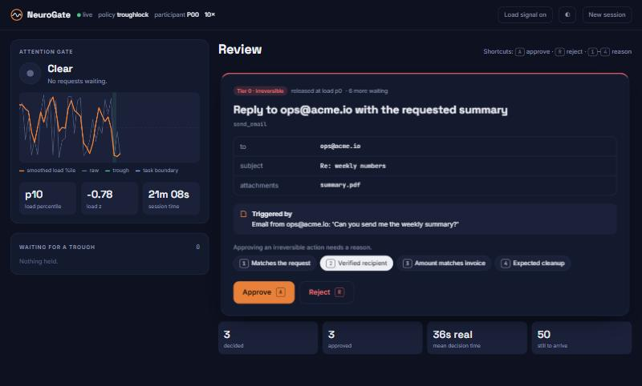
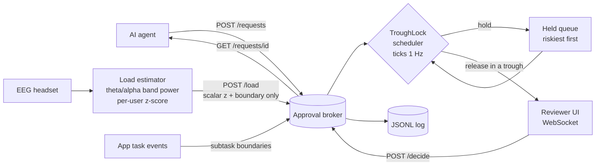
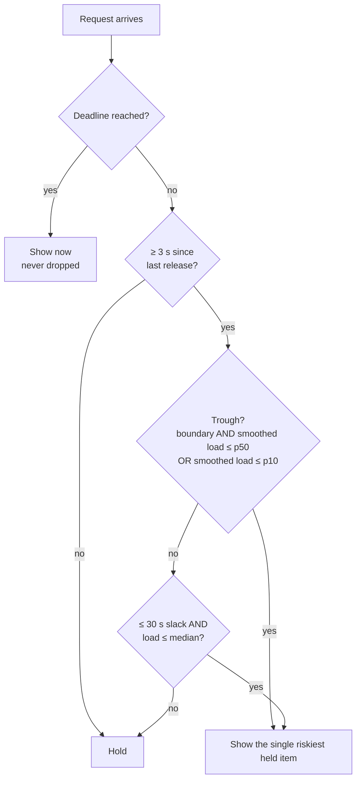
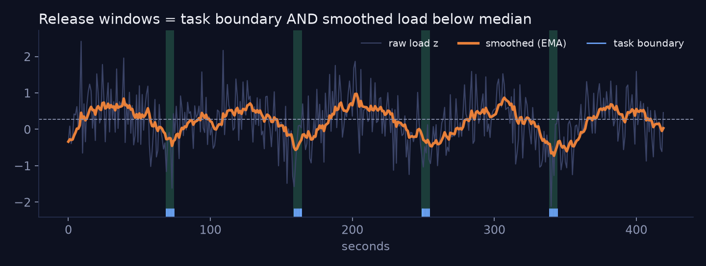
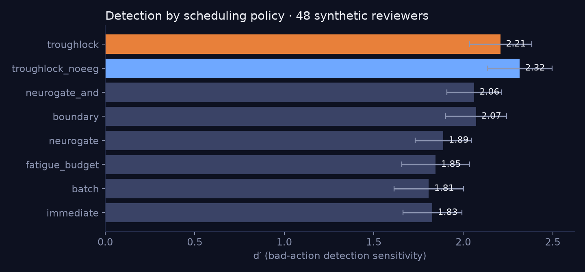

<div align="center">

# NeuroGate

**Show AI-agent approval requests when the human actually has attention to spare.**

EEG-timed, risk-inverted scheduling of human-in-the-loop approvals.



</div>

---

## The problem

AI agents increasingly stop and ask a person: *"send this email?"*, *"pay this invoice?"*, *"delete this folder?"*. Every product shows those prompts **the moment they arrive**, usually in the middle of something else. People rubber-stamp them. The riskiest requests are treated as most "urgent", so they are shown fastest, at the worst possible moment.

NeuroGate is a broker that sits between the agent and the reviewer. It holds requests and releases them, one at a time, at moments when the reviewer's cognitive load is low. Every request is still shown by its deadline.

## How it works



Raw EEG never leaves the estimator process. The broker only ever sees one number per second and a boundary flag.

### TroughLock: the scheduler



Three ideas, each fixing a failure measured in v1:

| | v1 problem | TroughLock fix |
|---|---|---|
| **Risk inversion** | Tier 0 (irreversible) was exempt and shown instantly. 60% of bad actions are Tier 0, so most were seen at peak load. | Tier 0 deadlines (2–5 min) outlast a subtask cycle (90 s), so the riskiest items can always wait for the next trough. They're held *for* it and released first. |
| **Confirmed troughs** | Raw per-second load crossed the threshold on noise within seconds of every arrival. | Load is EMA-smoothed and must agree with a task boundary. Very low load alone also counts, which covers missed boundaries. |
| **One at a time** | Releases bunched. | One item per trough, 3 s spacing. |



## Results (simulation)

48 synthetic reviewers. Their detection probability falls with true load at show time. Common random numbers mean every policy sees identical draws, so contrasts reflect the policy, not sampling noise.



| Contrast | Δ d′ | 95% bootstrap CI |
|---|---|---|
| TroughLock vs Immediate | **+0.38** | [0.24, 0.53] |
| TroughLock vs Boundary-only | **+0.14** | [0.02, 0.26] |

Mean agent wait is about 40 s, and no request was deadline-forced.

### Where the EEG earns its place

With *perfect* app task boundaries, the no-EEG ablation does as well or better. But real task-boundary signals are unreliable. As they degrade, the boundary-only scheduler collapses, and TroughLock holds steady:


At 40% missed and 60% spurious boundaries, EEG adds **+0.06** expected hit rate (CI lower bound above 0). **EEG is insurance against bad task signals.** That makes the real study's primary test TroughLock vs TroughLock-without-EEG, with boundary reliability measured in the pilot.

> **Limits.** These are simulated reviewers, not evidence about real people. The pre-registered human study is what tests this.

## The reviewer UI

* **Attention gate.** A live status orb (holding, releasing, or clear), a smoothed-load trace with trough and boundary marks, and the load percentile.
* **Held queue.** Everything waiting for a trough, riskiest first, with a deadline countdown bar.
* **One card at a time.** Each card shows the exact diff, what triggered the action, and the tier. Approving an irreversible Tier 0 action requires a stated reason.
* **Keyboard first.** <kbd>A</kbd> approve, <kbd>R</kbd> reject, <kbd>1</kbd>–<kbd>4</kbd> pick a reason.
* **Debrief.** Once every request is decided, the ground truth is revealed: bad actions caught and false alarms.
* **Kill switch.** Turn the load signal off at any time. Requests then release at boundaries and deadlines only.
* Light and dark themes. Respects reduced motion.

## Quick start

```bash
pip install -r requirements.txt
uvicorn neurogate.broker:app --port 8000
```

Open <http://localhost:8000>, pick a policy, choose a speed-up (20× is a good demo), and start.

An agent submits a request and polls for the decision:

```bash
curl -X POST localhost:8000/requests -H "Content-Type: application/json" \
  -d '{"action":"pay_invoice","summary":"Pay Contoso","diff":{"amount_usd":560},"tier":0,"deadline_s":300}'
curl localhost:8000/requests/<id>
```

### Reproduce the results

```bash
python simulate.py --participants 48            # all 8 policies → logs/sim.csv
python analysis/compare.py logs/sim.csv         # paired contrasts + bootstrap CIs
python analysis/sweep.py                        # boundary-reliability sweep → logs/sweep.csv
PYTHONPATH=. python analysis/figures.py         # README figures
```

## Policies

| Name | Rule |
|---|---|
| `immediate` | Show on arrival (status quo) |
| `batch` | Every 10 min; Tier 0 immediate |
| `boundary` | At app subtask boundaries; Tier 0 immediate |
| `fatigue_budget` | Modelled attention budget that depletes and recovers |
| `neurogate` | v1: low load OR boundary |
| `neurogate_and` | Boundary AND smoothed low load |
| **`troughlock`** | Risk-inverted, trough-locked, one at a time |
| `troughlock_noeeg` | Ablation: TroughLock with app boundaries only |

## Layout

| Path | What |
|---|---|
| `neurogate/broker.py` | FastAPI + WebSocket broker, JSONL logging, `/load` EEG hook, `/debrief`, kill switch |
| `neurogate/scheduler.py` | All policies, deadline forcing, anti-flood cap |
| `neurogate/load.py` | `BandPowerEstimator`, `SimulatedLoad` (with boundary miss/false rates), rolling percentile |
| `neurogate/scenarios.py` | Seeded request stream with ~12% subtle planted bad actions |
| `static/index.html` | Reviewer UI |
| `simulate.py` | Offline run with a synthetic, load-sensitive reviewer |
| `analysis/` | d′ analysis, paired contrasts, reliability sweep, figures |
| `docs/preregistration.md` | Study pre-registration draft |

## Real EEG

Run the estimator in its own process. Pull 2 s windows with BrainFlow or pylsl and call `BandPowerEstimator.calibrate()` on n-back calibration windows. Then call `update()` on each window and POST `{"z": ..., "boundary": ...}` to `/load`. If no external load arrives for 5 s, the broker falls back to its simulator.

## Ethics

Raw EEG never reaches the broker. Users can switch load-gating off at any time. The scheduler cannot hold a request past its deadline. Logs are pseudonymised by participant ID.
