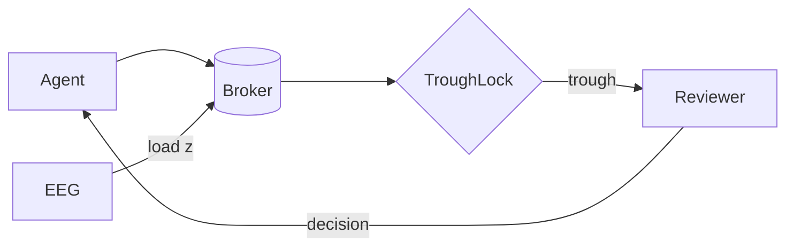
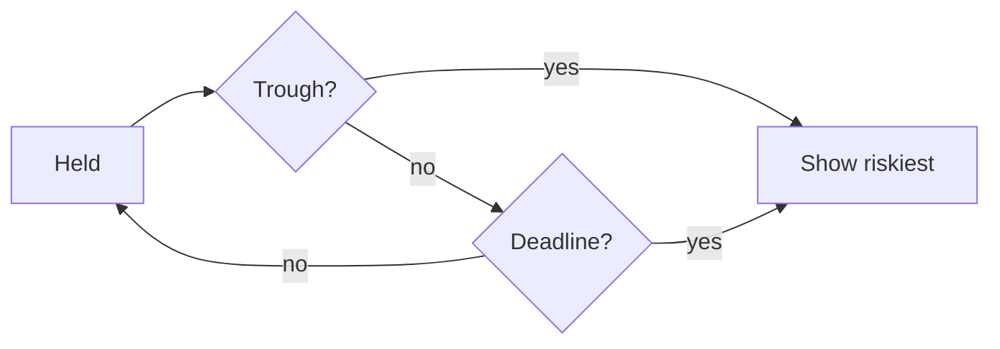
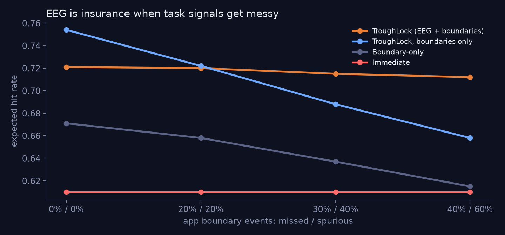

<div align="center">

# NeuroGate

**Show AI-agent approval requests when you actually have attention to spare.**


</div>

## Why

AI agents keep stopping to ask *"send this? pay this? delete this?"*. Today those prompts appear the instant they arrive, usually mid-task, so people rubber-stamp them. NeuroGate holds each request and releases it at a low-load moment, measured by EEG, riskiest first. Every request is still shown by its deadline.

## How



**TroughLock** releases one request when **boundary AND low load**, or very low load on its own:




## Results (simulated reviewers)


| TroughLock vs | Δ d′ | 95% CI |
|---|---|---|
| Immediate | **+0.38** | [0.24, 0.53] |
| Boundary-only | **+0.14** | [0.02, 0.26] |

Mean wait ~40 s. No request was forced by its deadline.

**EEG is insurance.** With clean app task boundaries it adds nothing. As boundaries get unreliable, the no-EEG version collapses and TroughLock holds:



> Simulated reviewers only. The pre-registered human study is the real test.

## Run it

```bash
pip install -r requirements.txt
uvicorn neurogate.broker:app --port 8000
```

Open <http://localhost:8000> and start a session (20× speed is a good demo). Keys: <kbd>A</kbd> approve, <kbd>R</kbd> reject, <kbd>1</kbd>–<kbd>4</kbd> reason.

<details>
<summary>Reproduce the results, agent API, layout</summary>

```bash
python simulate.py --participants 48
python analysis/compare.py logs/sim.csv
python analysis/sweep.py
PYTHONPATH=. python analysis/figures.py
```

An agent submits a request with `POST /requests` and polls `GET /requests/{id}`.

| Path | What |
|---|---|
| `neurogate/broker.py` | FastAPI + WebSocket broker, `/load` EEG hook |
| `neurogate/scheduler.py` | All 8 policies |
| `neurogate/load.py` | EEG band-power estimator and simulator |
| `static/index.html` | Reviewer UI |
| `analysis/` | d′, contrasts, sweep, figures |

For real EEG, run `BandPowerEstimator` in its own process and POST `{"z", "boundary"}` to `/load`. Raw EEG never reaches the broker.
</details>

## Security and ethics

This is a localhost-only prototype with no authentication. Don't expose it on a network. Load gating can be switched off at any time, nothing is held past its deadline, and logs are pseudonymised.
